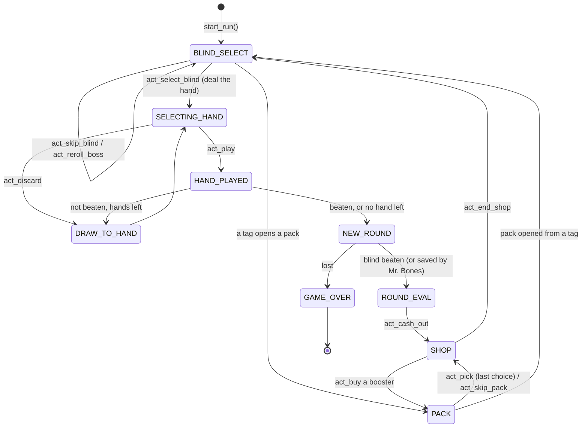

# Game flow

A run is a state machine, as in the game: `G.STATE` takes the values of
`balatro.STATES`, which are the game's `G.STATES`. Six states wait for the
player. The others are transitions, which the engine runs through on its own
within an action.

`PACK` stands for the five pack states: `TAROT_PACK`, `PLANET_PACK`,
`SPECTRAL_PACK`, `STANDARD_PACK` and `BUFFOON_PACK`.

| State | Value | Waits for the player | |
|---|---|---|---|
| `SELECTING_HAND` | 1 | yes | a blind is being played |
| `HAND_PLAYED` | 2 | | a hand is being scored |
| `DRAW_TO_HAND` | 3 | | cards are being drawn |
| `GAME_OVER` | 4 | yes (the end) | the run is lost |
| `SHOP` | 5 | yes | |
| `BLIND_SELECT` | 7 | yes | |
| `ROUND_EVAL` | 8 | yes | the cash-out screen |
| `TAROT_PACK`, `PLANET_PACK`, `SPECTRAL_PACK`, `STANDARD_PACK`, `BUFFOON_PACK` | 9, 10, 15, 17, 18 | yes | a booster pack is open |
| `NEW_ROUND` | 19 | | the round is ending |

`STATE_NAMES` maps values to names. `G.is_game_over()` and `G.in_pack()` test
the obvious, and `G.in_shop()` is true while the shop is open and usable.

## How an action runs

Every `act_*` method does three things:

1. **It checks the action** the way the game enables its buttons: right
   screen, enough money, room for the card, a valid selection.
   `IllegalAction` is raised otherwise, before anything changes.
2. **It applies it between two frames**, like a click. Card selections come
   first: the cards are selected and the game is let settle, as a player
   selects cards before pressing a button.
3. **It runs the game frame by frame** (`G.settle()`) until it waits for the
   player again: the event queue is empty, no lock is held, and the state
   function has finished, for four frames in a row. Everything the action
   sets off happens here: scoring, joker effects, drawing, dissolving cards,
   the next screen.

The engine runs at 60 frames per second and at the game speed given to
`Game(game_speed=...)`. That decides when animated effects land, which a few
interactions depend on (see [Internals](internals.md#the-event-queue-and-frames)).

## Blind select (`BLIND_SELECT`)

The ante has three blinds, Small, Big and Boss:

- `G.GAME.round_resets.blind_choices` has their keys.
- `G.GAME.round_resets.blind_states` has their states: `Select` (on deck),
  `Upcoming`, `Current`, `Defeated`, `Skipped`.
- `G.GAME.blind_on_deck` is the one on deck.
- `G.GAME.round_resets.blind_tags` holds the Small and Big blinds' skip tags.

The score each blind needs is
`get_blind_amount(ante) × blind mult × ante scaling`.

- **`act_select_blind()`** starts the blind on deck. The boss's effect is set
  up (debuffs, hand size, card flips), "setting blind" jokers trigger
  (Burglar, Cartomancer, Marble Joker...), the deck is shuffled, and the hand
  is drawn → `SELECTING_HAND`.
- **`act_skip_blind()`** (Small and Big only) adds the blind's tag, marks the
  blind `Skipped`, and puts the next blind on deck. Each tag triggers at its
  own moment:
  - **At once:** money (Economy, Speed, Handy, Garbage), a level-up
    (Orbital), jokers (Top-up), a new boss (Boss Tag), or a pack that opens
    (Charm, Buffoon, Meteor, Ethereal, Standard) → a pack state, which returns
    to `BLIND_SELECT`.
  - **In the next shop:** Voucher, Coupon, D6, Foil/Holographic/Polychrome/
    Negative, Uncommon, Rare.
  - **In the next round:** Juggle.
  - **After the boss:** Investment.
- **`act_reroll_boss()`** ($10; needs the Director's Cut voucher, once per
  ante, or Retcon) draws a new boss.

## Playing a blind (`SELECTING_HAND`)

The hand is `G.hand.cards`. `G.GAME.chips` is the score so far,
`G.GAME.blind.chips` the target. `G.GAME.current_round` has `hands_left` and
`discards_left`.

- **`act_play(cards)`** plays 1 to 5 cards (a Cerulean Bell forced card is
  always one of them):
  1. The cards move to the play area. The poker hand is found
     (`get_poker_hand_info`) and the boss can forbid it ("Not Allowed!").
  2. "Before" jokers trigger (Space Joker, Ride the Bus, Runner...).
  3. Each scoring card scores, left to right: its chips, enhancement, edition
     and seal, then the jokers that react to it, with retriggers (Red Seal,
     Hack, Dusk, Sock and Buskin, Hanging Chad, Seltzer).
  4. Held-in-hand effects follow (Steel cards, Baron, Shoot the Moon...),
     then every joker left to right, with its edition.
  5. The score is chips × mult (rounded down), added to `G.GAME.chips`.
     Cards destroyed by scoring go (a Glass Card that shatters, a card Sixth
     Sense destroys). "After" jokers trigger, and the played cards go to the
     discard pile.
  6. If `G.GAME.chips` reached the target, or no hand is left, the round ends
     (`NEW_ROUND`). Otherwise new cards are drawn → `SELECTING_HAND`.
- **`act_discard(cards)`** discards 1 to 5 cards (discard jokers trigger:
  Faceless, Trading Card, Castle, Hit the Road...) and draws as many.
- **`act_sort("rank" | "suit")`** sorts the hand. The choice sticks for later
  draws.
- **`act_move("hand" | "jokers" | "consumeables", from, to)`** reorders
  cards. Joker order matters (Blueprint, Brainstorm, scoring order).
- **`act_use(i, targets)`** uses consumable `i`. `targets` are the hand
  positions to select first, for Tarot and Spectral cards that need them.
- **`act_sell(area, i)`** sells a joker or a consumable.

## End of round (`NEW_ROUND` → `ROUND_EVAL` or `GAME_OVER`)

When the round ends:

- If the blind isn't beaten and no hand is left, the run is lost
  (`GAME_OVER`). The exception is Mr. Bones, when the score is at least a
  quarter of the target: it is destroyed and the run goes on.
- End-of-round effects trigger: held Gold cards, Blue seals, jokers that
  grow or count down (Ice Cream, Popcorn, Gros Michel, Egg, Rocket...),
  rental costs, perishable counters.
- Beating the boss raises the ante. Beating the boss of ante 8 (`win_ante`)
  wins the run: `G.GAME.won` becomes true. The game shows its win screen, and
  the engine presses *Endless mode*: the run goes on until it is lost.
- The cash-out screen appears (`ROUND_EVAL`). `G.round_eval_rows` lists its
  rows: the blind's reward, `$1` per hand left, discards (Green Deck), jokers
  (Golden Joker, Cloud 9, Rocket, Satellite...), tags (Investment), interest.

**`act_cash_out()`** adds them up, resets the round score, and opens the
shop → `SHOP`.

## The shop (`SHOP`)

The areas are `G.shop_jokers` (card slots: jokers, consumables, playing
cards), `G.shop_vouchers` and `G.shop_booster`.

- **`act_buy("shop_jokers", i)`** buys a card. With `use=True`, it buys a
  consumable and uses it at once.
- **`act_buy("shop_vouchers", i)`** redeems the voucher.
- **`act_buy("shop_booster", i)`** opens a pack → a pack state.
- **`act_reroll()`** restocks the card slots. It costs
  `G.GAME.current_round.reroll_cost`, which rises by $1 per reroll. Chaos the
  Clown gives one free reroll per shop, and the D6 Tag makes rerolls start at
  $0.
- **`act_sell`, `act_use`, `act_move`** work as in a round.
- **`act_end_shop()`** closes the shop → `BLIND_SELECT` for the next blind.

## Booster packs (pack states)

`G.pack_cards.cards` holds the choices and `G.GAME.pack_choices` how many can
still be taken. For Arcana and Spectral packs the hand is dealt (from the
deck) so targets can be chosen.

- **`act_pick(i, targets=None)`** takes a joker or playing card, or uses a
  Tarot, Planet or Spectral card (with `targets` if it needs them). The pack
  closes when no choice is left.
- **`act_skip_pack()`** closes it now.

The pack returns to where it was opened from: the shop, or the blind select
screen (tag packs).

## Game over (`GAME_OVER`)

Nothing more can be done: `legal_actions()` is empty and every action raises
`IllegalAction`.

## What can be done when

| Action | `BLIND_SELECT` | `SELECTING_HAND` | `ROUND_EVAL` | `SHOP` | pack |
|---|---|---|---|---|---|
| select / skip blind, reroll boss | ✓ | | | | |
| play, discard, sort | | ✓ | | | |
| cash out | | | ✓ | | |
| buy, reroll, end shop | | | | ✓ | |
| pick, skip pack | | | | | ✓ |
| use a consumable without targets | ✓ | ✓ | ✓ | ✓ | ✓ |
| use a consumable with targets | | ✓ | | | Arcana, Spectral, Celestial |
| sell | ✓ | ✓ | ✓ | ✓ | ✓ |
| move jokers / consumables | ✓ | ✓ | ✓ | ✓ | ✓ |

Each consumable has its own conditions (`Card.can_use_consumeable`): a Planet
can be used any time, The Hermit needs money... `legal_actions()` applies them
all.
